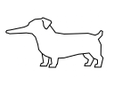

# Gardawg 

**Deterministic AI-code guardrails, physical-layer link analysis, and chaos testing in one offline-first binary.**

Gardawg is a 100% offline-first Rust CLI and MCP server by [Oceans Niagara, LLC](https://oceansniagara.com). It enforces deterministic AST rules and quality gates on your code, checks payloads against real physical-layer limits (LoRa, BLE, Wi-Fi, LEO satellite, UART), and runs seeded chaos/impairment proxies — with zero LLM dependencies inside Gardawg and zero code leaving your machine. AST rules cover Python, Rust, TypeScript, JavaScript, C and C++ (including Arduino `.ino`).

- **Website, WASM sandbox & licensing:** https://oceans-niagara.github.io/gardawg/
- **Interactive sandbox:** https://oceans-niagara.github.io/gardawg/sandbox.html

## What It Catches

* **`GR000` Syntax & stray fences:** parse errors and stray Markdown code fences, even without `tsc`/`cargo`/`ruff`.
* **`GR001` Money floats:** `f32`/`f64` on money and quantity identifiers.
* **`GR002` Missing timeouts:** `fetch`, `axios`, `reqwest`, `requests`, `httpx`, `socket.socket()`, `HTTPServer`, and C `recv`/`connect` calls without explicit timeouts.
* **`GR004`–`GR005` Swallowed errors & stubs:** empty `catch`/`except: pass`, ignored C returns, non-atomic state writes, `todo!()`, `NotImplementedError`, and placeholder comments.
* **`GR006`–`GR007` Security & panics:** hardcoded secrets (`sk_live_`, `AKIA`, `ghp_`, private keys), `eval`/`exec`/`shell=True`/`strcpy`, and non-test Rust `.unwrap()`.
* **Link budgets & AST rules:** `budget` computes the Shannon ceiling, MTU fragmentation, airtime, and BER loss; `--link` adds loop-send batching, framing, and timeout checks.
* **Chaos, verify & SARIF:** seeded TCP/UDP/HTTP impairment proxies, `gardawg verify`, and OASIS SARIF 2.1.0 output (`--format sarif`).

`init` detects your stack and generates `gardawg.toml`, `AGENTS.md`, `.mcp.json`, and `opencode.json`. Re-sync them after editing `gardawg.toml` with `gardawg sync`.

## Install & Multi-Project Quickstart

**Prebuilt binaries (no Rust required):** download from [GitHub Releases](https://github.com/Oceans-Niagara/gardawg/releases/latest). Headless builds suit CI and servers; `-gui` builds add the desktop dashboard.

| OS | Headless | GUI |
|---|---|---|
| Windows | `gardawg-windows-x86_64.exe` | `gardawg-gui-windows-x86_64.exe` |
| macOS (Apple Silicon) | `gardawg-macos-arm64` | `gardawg-gui-macos-arm64` |
| macOS (Intel) | `gardawg-macos-x86_64` | `gardawg-gui-macos-x86_64` |
| Linux | `gardawg-linux-x86_64` | `gardawg-gui-linux-x86_64` |

### Option 1: Global `PATH` Install (Recommended for Multiple Repos)

Run `gardawg install` (alias `install-path`) to copy the binary + adjacent `gardawg.lic` into `%LOCALAPPDATA%\Programs\gardawg` (Windows) or `~/.local/bin` (macOS/Linux) and add it to your user `PATH` — or move `gardawg.exe` + `gardawg.lic` there manually:

```powershell
# Windows (PowerShell)
.\gardawg-windows-x86_64.exe install

# In ANY repo root (new terminal):
gardawg init --link
gardawg check --format text
```

```bash
# macOS / Linux
chmod +x ./gardawg-macos-arm64
./gardawg-macos-arm64 install
gardawg init --link
```

`init --link` defaults to `wifi-24g-congested` (for general networked apps). Pass `--link-profile ble-1m` or `--link-profile lora-sf12` for constrained RF/serial links, or edit `[link] profile = "..."` in `gardawg.toml` anytime.

### Option 2: Point at Any Project Without Modifying `PATH` (`-w`)

```powershell
.\gardawg-windows-x86_64.exe -w C:\path\to\project init --link
```

`init` automatically writes the binary's full path into `.mcp.json` and `opencode.json`, so MCP works from your AI tools even without `gardawg` on `PATH`.

## Build from Source & Core Commands

```bash
cargo install --git https://github.com/Oceans-Niagara/gardawg
cargo install --git https://github.com/Oceans-Niagara/gardawg --features gui

gardawg check --format sarif
gardawg budget --profile lora-sf12 --bytes 64 --hz 10
gardawg proxy --listen 127.0.0.1:9000 --target 127.0.0.1:9001 --profile ble-1m --seed 42
gardawg verify --profile wifi-24g-congested --udp --listen 127.0.0.1:9000 --upstream 127.0.0.1:9001 --cmd "python client.py"
gardawg resilience --openapi openapi.yaml
gardawg mcp
```

**`gardawg resilience` example:** pass `--openapi openapi.yaml` (requires `schemathesis` on `PATH`) or set `[resilience] openapi_spec` / `keploy_cmd` in `gardawg.toml`. Start your API on `127.0.0.1:8080` (or set `[resilience] upstream`), then run `gardawg resilience --openapi openapi.yaml`.

## Desktop GUI (`gardawg-gui`)

Download the `-gui` binary (or build with `--features gui`). Launch it with no arguments (`gardawg-gui`) and use the top toolbar **Mode** switcher to toggle anytime between **Standalone Simulator** and **Live Proxy** (with editable Listen/Target endpoints and TCP/UDP selection), or pass `--target` on the CLI to start directly in live proxy mode:

```powershell
# Standalone simulator & interactive payload calculator (no --target needed)
.\gardawg-gui-windows-x86_64.exe

# Live UDP impairment proxy + real-time throughput/drop plots
.\gardawg-gui-windows-x86_64.exe gui --udp --listen 127.0.0.1:9000 --target 127.0.0.1:9001 --profile ble-1m
```

## AI Agents (MCP) & Local Models

Gardawg itself is 100% offline — your host coding CLI (OpenCode, Claude Code, Cursor, Windsurf, etc.) chooses which LLM runs.

* **Primary Workflow — Agentic MCP Guardrails (`AGENTS.md` + `.mcp.json` / `opencode.json`):** `gardawg init` wires Gardawg's stdio MCP server into your project and writes a 3-step `AGENTS.md` contract (`evaluate_payload` -> `gardawg_check` -> `verify_runtime`). Pair it with OpenCode's built-in models or any tool-capable coding model so your agent checks link budgets before designing frames, fixes AST findings after every edit, and smoke-tests through the impairment proxy automatically.
* **100% Local Ollama in `opencode.json`:** `gardawg init` includes a commented Ollama `"provider"` template (`http://127.0.0.1:11434/v1` with `"tool_call": true`) in `opencode.json` so you can uncomment it with any tool-capable `ollama list` tag.
* **Lightweight CLI Repair Helper (`gardawg fix`):** for localized single-file fixes (such as adding missing `timeout=` arguments or moving hardcoded secrets to `os.environ`) using small local Ollama models (1.5B–3B) without full agentic overhead:

```bash
gardawg fix --model ollama/qwen2.5-coder:3b
gardawg fix --model ollama/qwen2.5-coder:1.5b --file src/client.py --dry-run
```

## Licensing

Offline Ed25519-signed keys (`LG1...`), verified locally with zero network calls. Perpetual, one-time purchase.

**License lookup order (first match wins):**
1. `--license-key <key-or-path>`
2. `GARDAWG_LICENSE_KEY` (or `LINKGUARD_LICENSE`) environment variable
3. `./gardawg.lic` (or `./linkguard.lic`) in the current working directory
4. `<exe_dir>/gardawg.lic` (or `<exe_dir>/linkguard.lic`) next to the `gardawg` binary (global fallback across all repos)
5. `%APPDATA%\gardawg\license.lic` (Windows) or `~/.config/gardawg/license.lic` (macOS/Linux)

Verify anytime with `gardawg license`.

* **Free ($0):** core CLI, AST rules, quality gates, SARIF output, built-in link profiles, seeded proxy/chaos/verify, `gardawg fix --model ollama/<tag>`, stdio MCP server, and browser sandbox.
* **Pro ($19.99 one-time — Local Workstations):** everything in Free, plus `gardawg resilience`, custom `profiles.toml`, local `--baseline` ratchet, and `gardawg-gui` desktop dashboard with CSV/JSON export (`ci_allowed: false` — local workstations only).
* **Team ($59.99 one-time — Up to 6 Seats + CI):** everything in Pro, plus CI/CD runner support (`ci_allowed: true`), `gardawg sync --check` config drift gate, `[agents].custom_rules` enforcement, and offline 90-day contributor cap (`<= 6` non-bot committers via `git shortlog`).
* **Enterprise ($299+ — Unlimited Seats & CI):** everything in Team with `max_seats: null` (unlimited developers & CI runners), multi-profile matrix sweeps (`gardawg check --profile-matrix ble-1m,wifi-24g-congested,lora-sf12`), and organization-stamped SARIF audit headers (`Licensed to <Org> — Enterprise`).

© 2026 Oceans Niagara, LLC • connect@oceansniagara.com